# 🌙 JaKing Lunar Colony Collection: Roblox Classic Shirts

**10 original Roblox classic shirt templates** (plus 2 matching pants) themed around space exploration, coding, robotics and engineering. They're built for STEM students, NASA fans, programmers, robotics teams and engineering clubs.

🌐 **[Open the live gallery website](https://jaigod.github.io/lunar-colony-collection/)** · 📦 [Download all (ZIP)](https://github.com/JaiGod/lunar-colony-collection/archive/refs/heads/main.zip) · 🛠️ [Creator Hub](https://create.roblox.com/)

Every item shares the same **Lunar Colony branding**: a hex-and-crescent emblem on the chest, matching trim and cuffs, Poppins typography, and a short lore line. Each shirt has its own colour palette. All designs are original, contain no third-party logos or characters, and are appropriate for all ages.

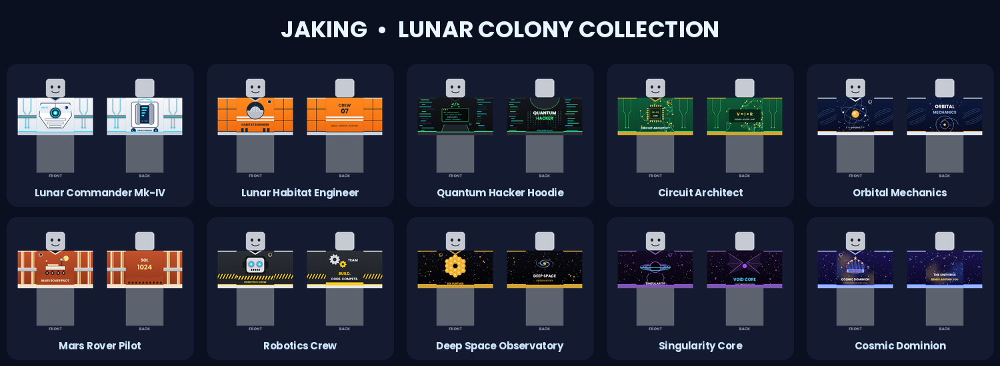

## 📑 Contents

1. [Lunar Commander Mk-IV](#1-lunar-commander-mk-iv)
2. [Lunar Habitat Engineer](#2-lunar-habitat-engineer)
3. [Quantum Hacker Hoodie](#3-quantum-hacker-hoodie)
4. [Circuit Architect](#4-circuit-architect)
5. [Orbital Mechanics](#5-orbital-mechanics)
6. [Mars Rover Pilot](#6-mars-rover-pilot)
7. [Robotics Crew](#7-robotics-crew)
8. [Deep Space Observatory](#8-deep-space-observatory)
9. [Singularity Core](#9-singularity-core)
10. [Cosmic Dominion](#10-cosmic-dominion)

Also: [Matching sets](#-matching-sets) · [Upload guide](#-uploading-a-shirt-to-the-roblox-creator-hub) · [Links](#-links)

---

## 📁 Repository layout

```
/shirts      10 shirt templates, 585×559 PNG (Roblox classic shirt format)
/pants       2 matching pants templates, 585×559 PNG
/previews    front/back avatar mockups, matching-set previews, collection sheet
/tools       generate.py (renders every PNG) + build_docs.py (README & website)
index.html   browser gallery website (GitHub Pages)
README.md
```

## 👕 The shirts

### 1. Lunar Commander Mk-IV

<a href="shirts/lunar_commander_mk4_shirt.png">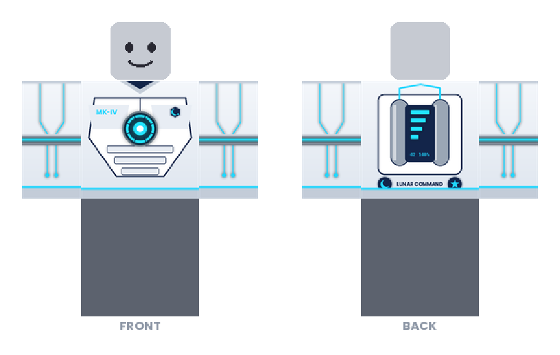</a>
<a href="shirts/lunar_commander_mk4_shirt.png">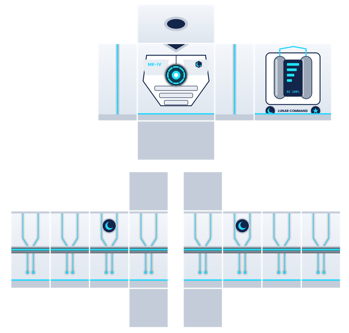</a>

**Theme:** Flagship armored suit top for the colony's commanding officer.
**Palette:** `#f4f7fb` · `#1fd6ff` · `#7fe9ff` · `#c3ccd8`
> *"Lead humanity's first permanent lunar settlement. Built for explorers, engineers, and visionaries."*

📥 [View template](shirts/lunar_commander_mk4_shirt.png) · [Direct download](https://github.com/JaiGod/lunar-colony-collection/raw/main/shirts/lunar_commander_mk4_shirt.png)

### 2. Lunar Habitat Engineer

<a href="shirts/lunar_habitat_engineer_shirt.png">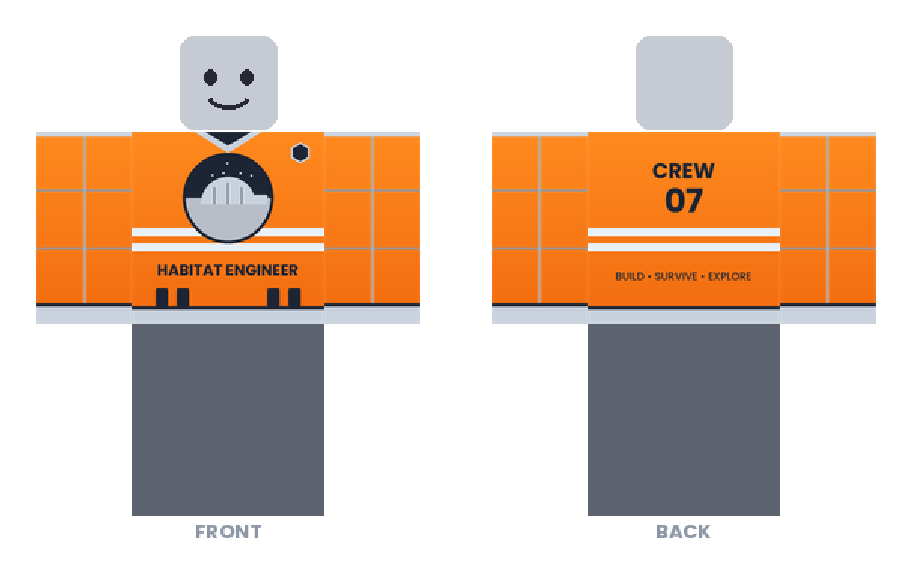</a>
<a href="shirts/lunar_habitat_engineer_shirt.png">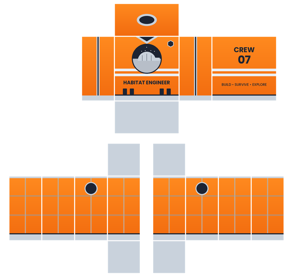</a>

**Theme:** Hi-vis work shirt for the crews who build and maintain the colony's pressurized domes.
**Palette:** `#ff8a1f` · `#1d2433` · `#e9f0f7` · `#c9d2dc`
> *"Every dome on the Moon was raised by someone in this shirt."*

📥 [View template](shirts/lunar_habitat_engineer_shirt.png) · [Direct download](https://github.com/JaiGod/lunar-colony-collection/raw/main/shirts/lunar_habitat_engineer_shirt.png)

### 3. Quantum Hacker Hoodie

<a href="shirts/quantum_hacker_hoodie_shirt.png">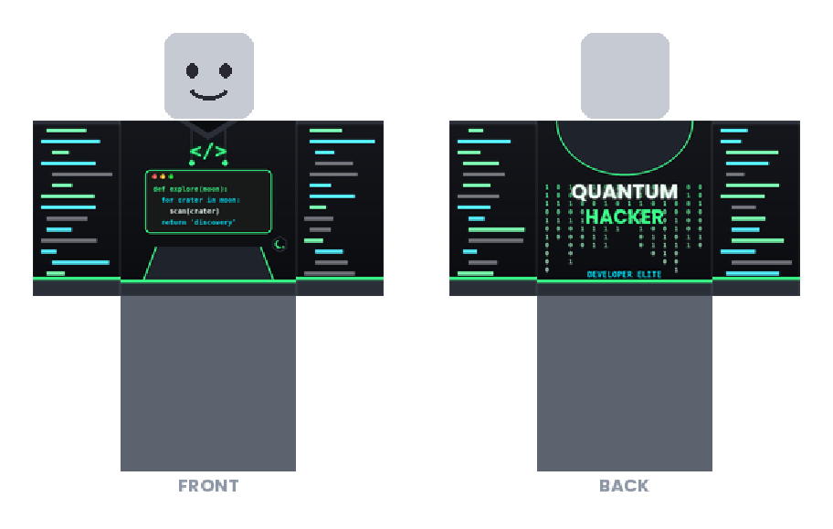</a>
<a href="shirts/quantum_hacker_hoodie_shirt.png">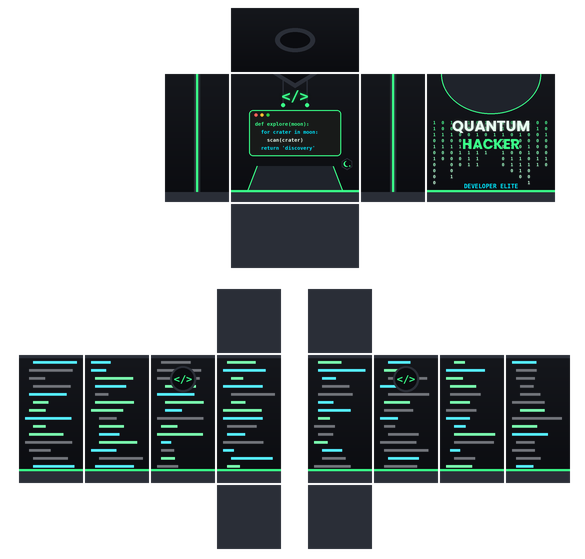</a>

**Theme:** Developer Elite hoodie — terminal window, binary rain and neon trim for programmers.
**Palette:** `#15171c` · `#39ff88` · `#00e5ff` · `#2a2e37`
> *"Compiles at the speed of light. Debugs across parallel universes."*

📥 [View template](shirts/quantum_hacker_hoodie_shirt.png) · [Direct download](https://github.com/JaiGod/lunar-colony-collection/raw/main/shirts/quantum_hacker_hoodie_shirt.png)

### 4. Circuit Architect

<a href="shirts/circuit_architect_shirt.png">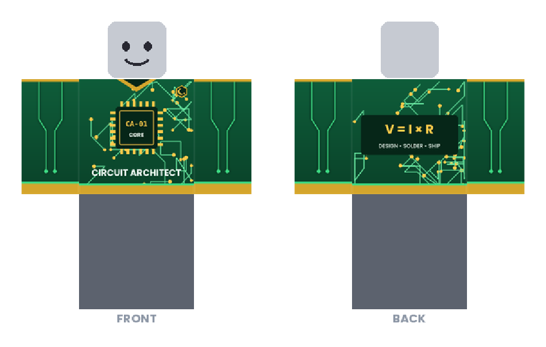</a>
<a href="shirts/circuit_architect_shirt.png">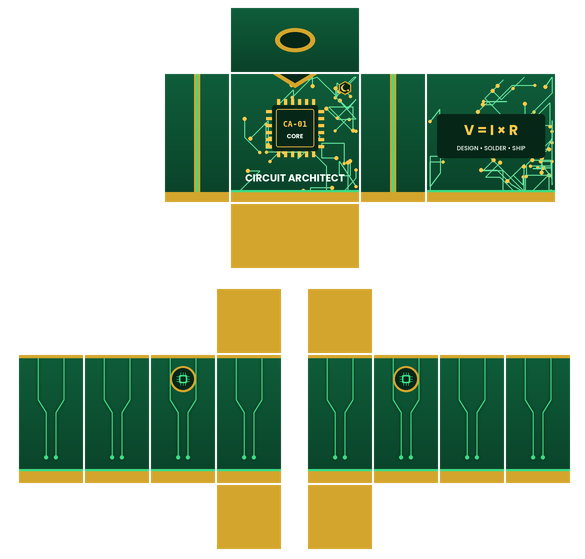</a>

**Theme:** Green PCB with gold traces and a central processor — for electronics and hardware builders.
**Palette:** `#0f5d3a` · `#3ddc84` · `#ffc94a` · `#d4a52c`
> *"Designs the nervous system of every machine on the colony."*

📥 [View template](shirts/circuit_architect_shirt.png) · [Direct download](https://github.com/JaiGod/lunar-colony-collection/raw/main/shirts/circuit_architect_shirt.png)

### 5. Orbital Mechanics

<a href="shirts/orbital_mechanics_shirt.png">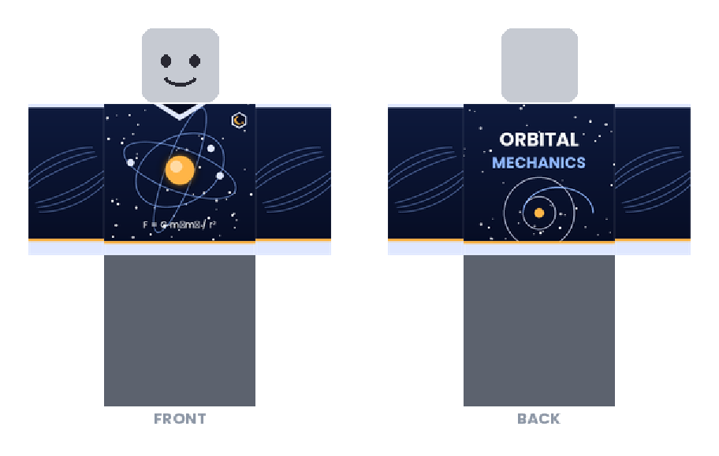</a>
<a href="shirts/orbital_mechanics_shirt.png">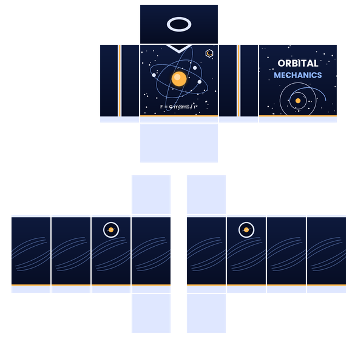</a>

**Theme:** Deep navy star chart with orbital ellipses, a glowing planet and the law of gravitation.
**Palette:** `#0e1a3d` · `#ffb547` · `#8fb6ff` · `#dfe7ff`
> *"Every launch window is a math problem. Solve it."*

📥 [View template](shirts/orbital_mechanics_shirt.png) · [Direct download](https://github.com/JaiGod/lunar-colony-collection/raw/main/shirts/orbital_mechanics_shirt.png)

### 6. Mars Rover Pilot

<a href="shirts/mars_rover_pilot_shirt.png">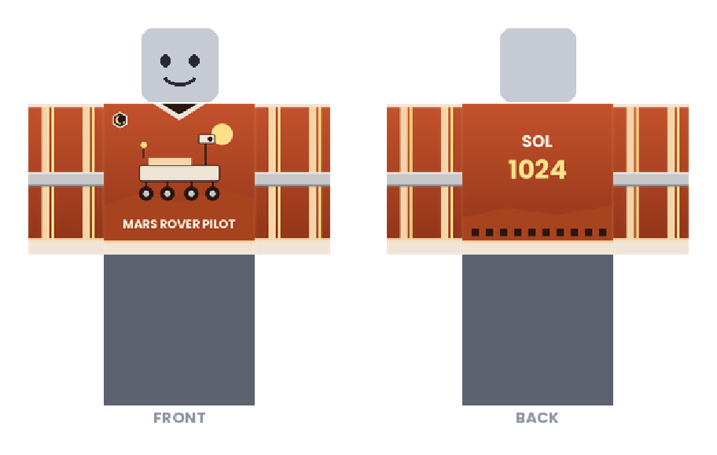</a>
<a href="shirts/mars_rover_pilot_shirt.png">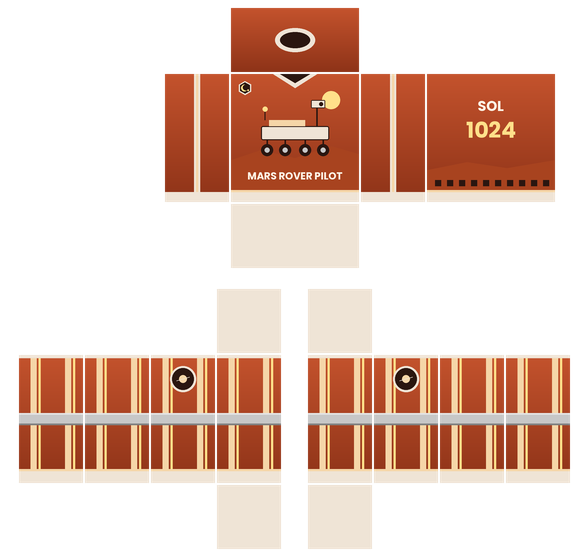</a>

**Theme:** Rust-red Martian dunes with a six-wheeled science rover — for planetary explorers.
**Palette:** `#c4532d` · `#f5d6a8` · `#ffe08a` · `#efe4d6`
> *"Sol 1024. Still driving. Still discovering."*

📥 [View template](shirts/mars_rover_pilot_shirt.png) · [Direct download](https://github.com/JaiGod/lunar-colony-collection/raw/main/shirts/mars_rover_pilot_shirt.png)

### 7. Robotics Crew

<a href="shirts/robotics_crew_shirt.png">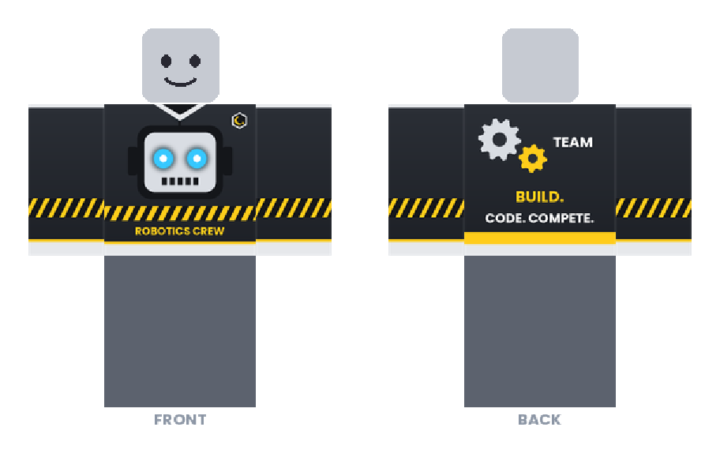</a>
<a href="shirts/robotics_crew_shirt.png">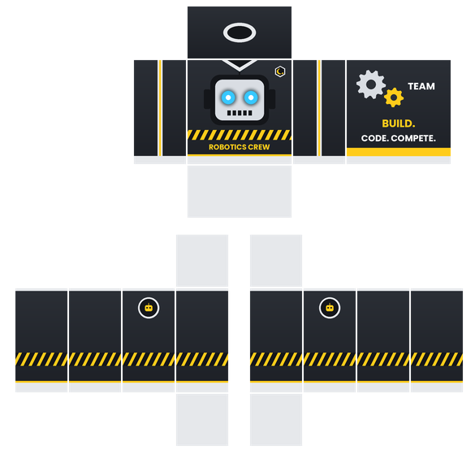</a>

**Theme:** Bold yellow-and-charcoal team shirt with a glowing robot face and hazard stripes.
**Palette:** `#2b2f36` · `#ffcc1a` · `#ffe066` · `#e6e8eb`
> *"Build. Code. Compete. Repeat until it walks."*

📥 [View template](shirts/robotics_crew_shirt.png) · [Direct download](https://github.com/JaiGod/lunar-colony-collection/raw/main/shirts/robotics_crew_shirt.png)

### 8. Deep Space Observatory

<a href="shirts/deep_space_telescope_shirt.png">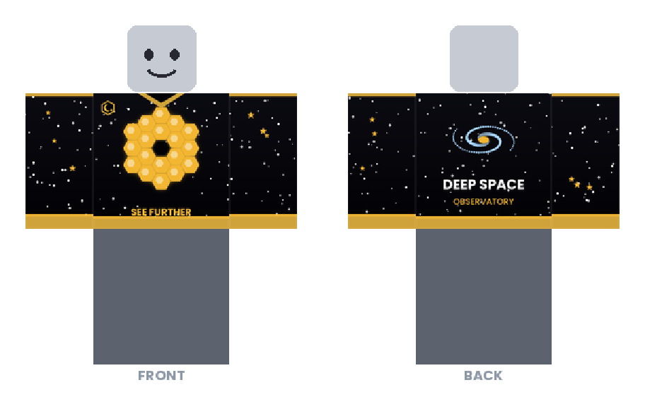</a>
<a href="shirts/deep_space_telescope_shirt.png">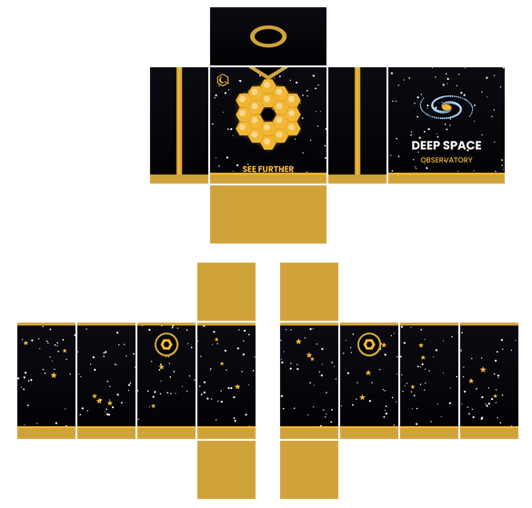</a>

**Theme:** Gold segmented hexagonal mirror on a black starfield, with a spiral galaxy on the back.
**Palette:** `#0b0b12` · `#f2b632` · `#9ad0ff` · `#cfa23a`
> *"Looks back 13 billion years so we can see what comes next."*

📥 [View template](shirts/deep_space_telescope_shirt.png) · [Direct download](https://github.com/JaiGod/lunar-colony-collection/raw/main/shirts/deep_space_telescope_shirt.png)

### 9. Singularity Core

<a href="shirts/singularity_core_shirt.png">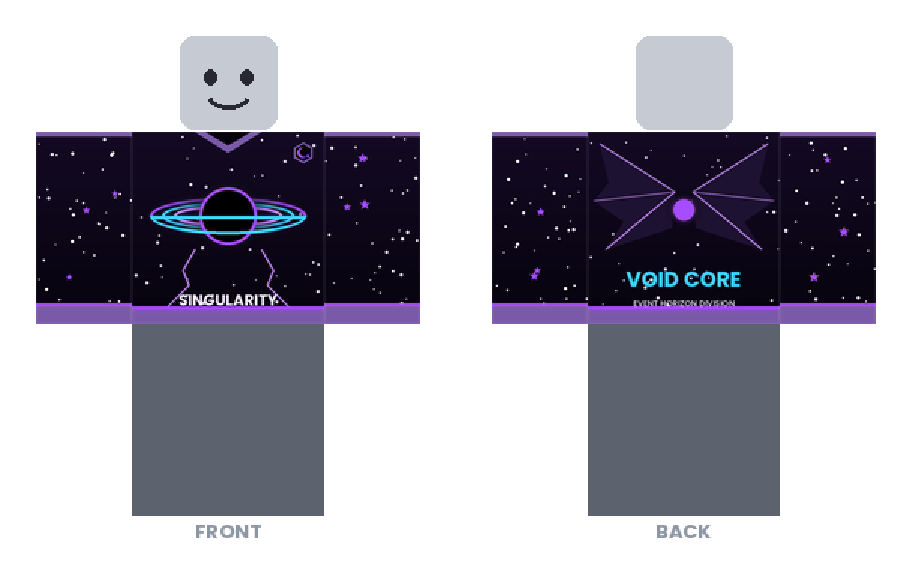</a>
<a href="shirts/singularity_core_shirt.png">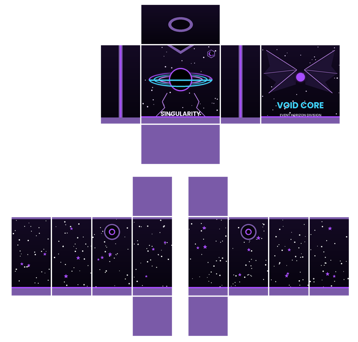</a>

**Theme:** Black hole with a glowing accretion disk and crystalline wings — matches the Void Core pet & Singularity Wings concepts.
**Palette:** `#140a24` · `#a64dff` · `#3fd0ff` · `#7a5aa8`
> *"Nothing escapes the event horizon. Not even style."*

📥 [View template](shirts/singularity_core_shirt.png) · [Direct download](https://github.com/JaiGod/lunar-colony-collection/raw/main/shirts/singularity_core_shirt.png)

### 10. Cosmic Dominion

<a href="shirts/cosmic_dominion_shirt.png">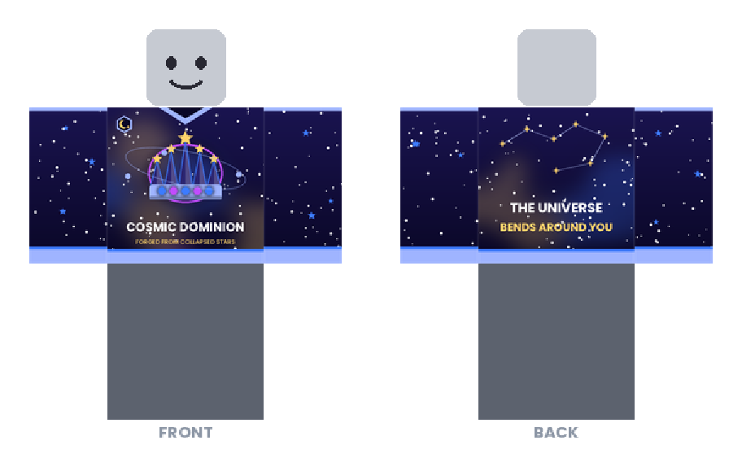</a>
<a href="shirts/cosmic_dominion_shirt.png">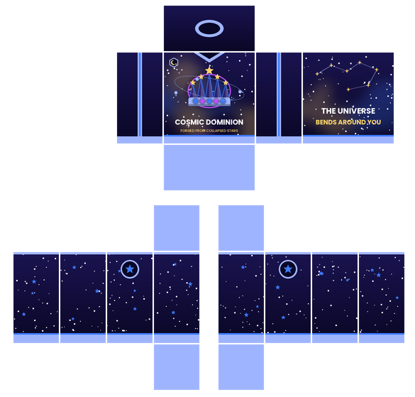</a>

**Theme:** Indigo nebula with an original star-crown sigil and orbiting asteroids — matches the Cosmic Dominion Crown concept.
**Palette:** `#1a1450` · `#3d7bff` · `#ffd36b` · `#9fb4ff`
> *"A relic forged from the remnants of collapsed stars. The universe bends around its wearer."*

📥 [View template](shirts/cosmic_dominion_shirt.png) · [Direct download](https://github.com/JaiGod/lunar-colony-collection/raw/main/shirts/cosmic_dominion_shirt.png)

## 👖 Matching sets

- **Lunar Commander Mk-IV Pants**: Matching armored legs: white plating, metallic knee joints with cyan glow, silver boots. → [template](pants/lunar_commander_mk4_pants.png) · [download](https://github.com/JaiGod/lunar-colony-collection/raw/main/pants/lunar_commander_mk4_pants.png)
- **Developer Elite Circuit Pants**: Matching Developer Elite pants: black with neon-green circuit traces and glowing cuffs. → [template](pants/circuit_pants.png) · [download](https://github.com/JaiGod/lunar-colony-collection/raw/main/pants/circuit_pants.png)

| Lunar Commander Mk-IV set | Developer Elite set |
|---|---|
| 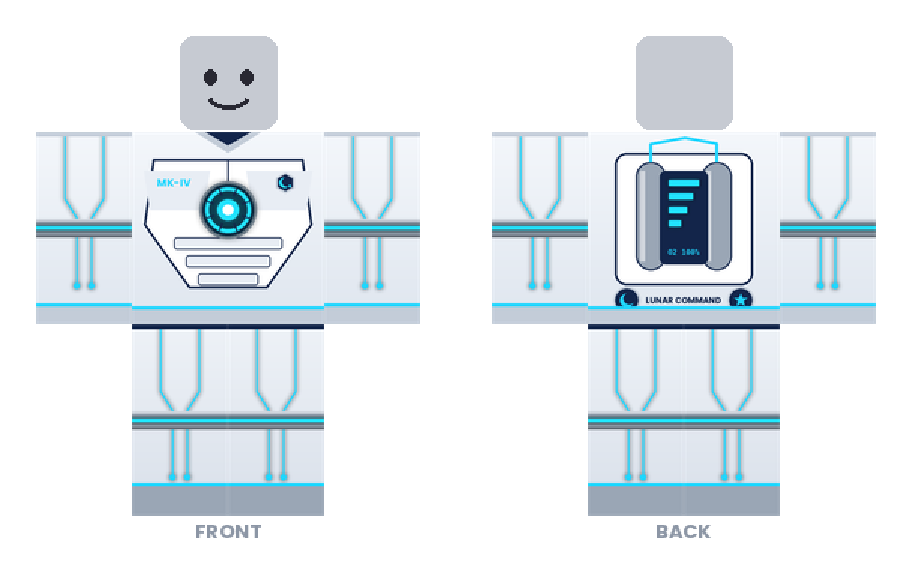 | 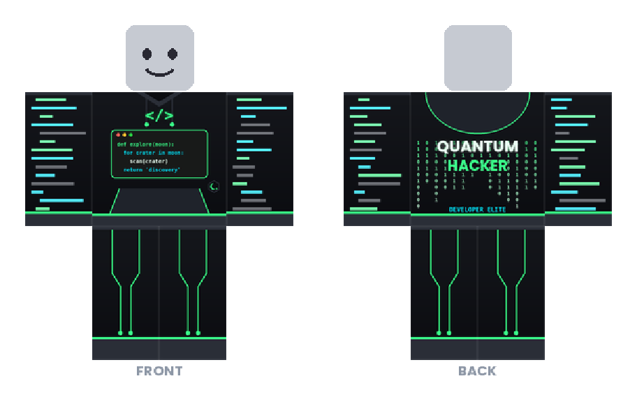 |
| 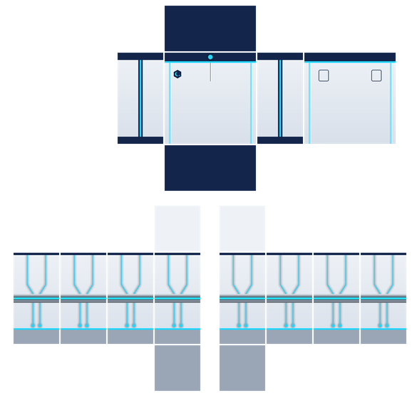 | 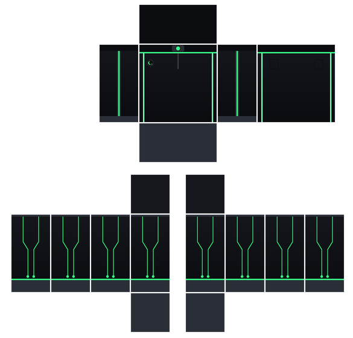 |

---

## 🚀 Uploading a shirt to the Roblox Creator Hub

> Roblox's menus and upload fees change from time to time. If something looks different, follow the labels in the Creator Hub. Official reference: [Classic clothing docs](https://create.roblox.com/docs/art/classic-clothing).

1. **Download the template.** Click any *Direct download* link above, or open the file on GitHub and press **Download raw file**. Keep it as a **585 × 559 PNG**. Don't resize or recompress it.
2. **Check your account.** You must be signed in to the account (or [group](https://www.roblox.com/communities)) that will own the item. Selling clothing generally requires [Roblox Premium](https://www.roblox.com/premium/membership).
3. **Open the Creator Hub.** Go to [create.roblox.com](https://create.roblox.com/) → **Creations** → **Avatar Items**.
4. **Upload.** Choose to upload an asset, pick **Classic Shirt** (or **Classic Pants** for files in `/pants`), and select the PNG.
5. **Name & describe it.** Use the name and lore line from this README, for example:
   - Name: `Lunar Commander Mk-IV`
   - Description: `Lead humanity's first permanent lunar settlement. Built for explorers, engineers, and visionaries. — JaKing Lunar Colony Collection`
6. **Pay the upload fee (if shown) and submit.** The item goes through moderation, which usually takes minutes to a few hours.
7. **Put it on sale.** Once approved, open the item → **Sales** → enable **Item for Sale** and set a Robux price.
8. **Test it.** Equip it in the [Avatar Editor](https://www.roblox.com/my/avatar), or in Roblox Studio put a `Shirt` in a rig and set `ShirtTemplate` to your asset ID.

### Template map

- **Big centre square:** torso front. **Right-hand square:** torso back. **Thin strips beside them:** torso sides. **Top/bottom rectangles:** shoulders and hem.
- **The two lower cross shapes:** right arm (left cross) and left arm (right cross). The face with the round patch is the outer shoulder.
- The transparent area between faces isn't used, so leave it transparent.

## 🛍️ Selling strategy

- Release the 10 shirts as one **themed drop** with consistent thumbnails (from `/previews`).
- Put "Lunar Colony Collection" in every description so they appear together in search.
- Bundle the shirts with their matching pants: **Mk-IV** and **Developer Elite**.
- **Planned 3D UGC companions** (Blender meshes, made separately through the [UGC program](https://create.roblox.com/docs/marketplace/publishing-to-marketplace)):
  Cosmic Dominion Crown · Quantum Hacker Visor · Lunar Commander Helmet · Void Core Shoulder Pet · Singularity Wings · Ancient AI Relic Halo.
  The *Cosmic Dominion* and *Singularity Core* shirts already match these. All concepts are original and don't copy any existing limited item.

## 🛠️ Editing / regenerating

```bash
pip install pillow
python3 tools/generate.py     # renders /shirts, /pants, /previews
python3 tools/build_docs.py   # rebuilds README.md and index.html
```

Each design is a pair of Python functions (`f_*` = front, `b_*` = back) plus a palette entry in `SHIRTS`, so recolouring or adding a new shirt takes only a few lines.

## 🔗 Links

- 🌐 Live gallery: [https://jaigod.github.io/lunar-colony-collection/](https://jaigod.github.io/lunar-colony-collection/)
- 📦 Repository: [https://github.com/JaiGod/lunar-colony-collection](https://github.com/JaiGod/lunar-colony-collection)
- 🧭 Roblox Creator Hub: [create.roblox.com](https://create.roblox.com/)
- 📘 Classic clothing docs: [create.roblox.com/docs/art/classic-clothing](https://create.roblox.com/docs/art/classic-clothing)
- 🧑‍💻 More projects: [github.com/JaiGod](https://github.com/JaiGod)
- ❤️ Support the creator: [Patreon](https://www.patreon.com/c/JaineilRana)
- 💼 Creator: [Jaineil Rana on LinkedIn](https://www.linkedin.com/in/jaineil-rana-89005736a)

---

© JaKing (Jaineil Rana). Original designs.
